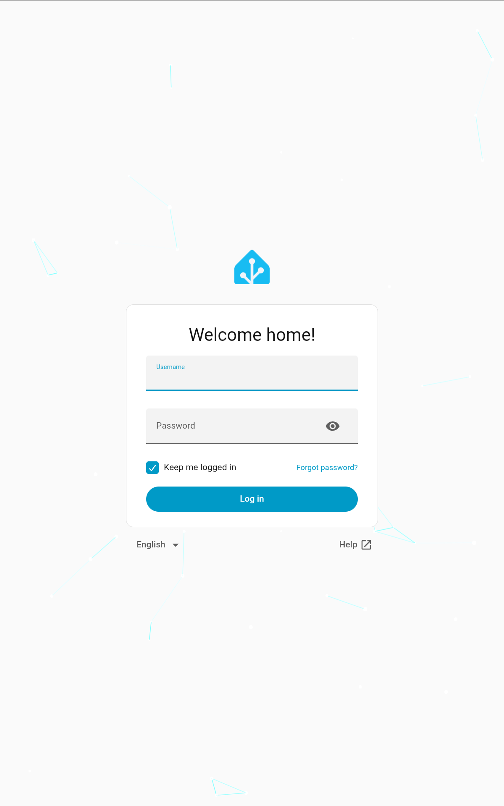

# Fire HD 10 (13th Gen, 2023) "tungsten" — temp-root runbook, unlock verdict, and kiosk recipe

Research notes and working scripts for the Amazon Fire HD 10 13th generation (2023,
model **KFTUWI**, codename **tungsten**, MediaTek MT8169, kernel 5.4.86, Fire OS 8.3.3.x).

**TL;DR**

| Goal | Result |
|---|---|
| Temporary root shell (uid=0, SELinux permissive) | ✅ works, reproducible, ~1 min |
| Persistent partitions backup while rooted | ✅ scripts included |
| Bootloader unlock | ❌ cryptographically impossible on this unit (evidence below) |
| Custom ROM / LineageOS / postmarketOS | ❌ requires the unlock |
| Debloated Always-on Home-Assistant-style kiosk | ✅ full recipe included |



---

## 1. The exploit — what it is and where it came from

**Nothing here is a new vulnerability.** The chain is entirely public work we assembled and verified:

- **CVE-2026-43499 ("GhostLock")** — a stack UAF in the Linux kernel's PI-futex/rtmutex
  path (`remove_waiter()` clearing `current->pi_blocked_on` instead of the waiter's on the
  proxy-lock `-EDEADLK` rollback). Present in every Linux kernel from 2.6.39 (2011) to 7.1
  (fixed April 2026). Discovered by [NebuSec](https://github.com/NebuSec/CyberMeowfia) —
  who turned it into a 97%-reliable LPE and won $92,337 in kernelCTF. Writeups:
  [part 2](https://nebusec.ai/research/ionstack-part-2/) (bug + Linux exploit),
  [part 3](https://nebusec.ai/research/ionstack-part-3/) (Android: CFI/KASLR bypass).
- **Fire OS adaptation** — [R0rt1z2/GhostLock](https://github.com/R0rt1z2/GhostLock)
  (branches 4.4 / 4.14 / 5.10) ported it to Amazon devices (Fire Max 11, Fire TV Sticks…).
- **This tablet's port** — [sshell/GhostLock](https://github.com/sshell/GhostLock),
  branch **`5.4-tungsten`** (Sept 2026), did the 5.4 port. That branch is what we build
  and run here. The hard parts it solves vs the 5.10 branch:
  - the select()-based stack reclaim is geometrically impossible on 5.4 (frame layout) —
    it replaces it with an IPv4-ping `setsockopt` live-frame reclaim;
  - on 5.4, *normal scheduler activity* can traverse the dangling waiter and panic the
    kernel — so it reworks the consumer into a cycle-precise (ARM `cntvct_el0`) trigger
    and does all expensive prep **before** the dangling state exists;
  - per-build offset registry (ours: Fire OS 8.3.3.6 shares the 8.3.3.7 kernel build
    `5.4.86-g3397a7c4f706`, so the banner-match entry applies).

### Why your Fire OS version matters

The exploit matches kernel build strings. It works on 8.3.3.6–8.3.3.8 (same kernel).
A future OTA that changes the kernel breaks it — the payload disables Amazon's OTA
packages on success for exactly this reason (re-enable commands in §4).

### Build & run

Requires: Android NDK r29 (host macOS arm64 works), `adb` + USB debugging on the tablet.

```bash
# clone sshell's port into this repo's root as ./GhostLock (gitignored), then:
cd GhostLock && git checkout 5.4-tungsten
make PROJECT=tungsten NDK_ROOT=/path/to/ndk-r29 \
     NDK_TOOLCHAIN=/path/to/ndk-r29/toolchains/llvm/prebuilt/darwin-x86_64
# then with the tablet on USB:
../scripts/run-tungsten.sh        # loop-until-root variant
../scripts/observe.sh             # single observed attempt with telemetry
```

**Reliability findings from our session** (the XDA thread says "very unstable, keep
retrying"; we can be more precise):

- ✅ **Best pattern: let the tablet sit booted and idle for a minute, then run once,
  no reboot.** Both our instant successes followed that pattern.
- ❌ Tight reboot→run→panic→reboot loops did measurably worse (0/6 and 0/8 streaks).
- A failed attempt often ends in a kernel panic + auto-reboot — harmless (nothing is
  written to flash), just retry.
- Expect uid=0 within 1–6 tries; the exploit parks a `su` daemon and a root bind shell
  on `127.0.0.1:9999`.

After rooting: `adb shell '/data/local/tmp/su -c "id"'` → `uid=0(root)`. Everything dies
on reboot (that's the point — it's a *temporary* root).

---

## 2. The unlock question — investigated end-to-end, answered "no"

The point of rooting was a bootloader unlock for open-source Android. **It cannot be
done on this unit with anything publicly known as of 2026-10-25.** Every link below was
tested on the device or read out of its own binaries — not assumed.

| Path | Evidence | Verdict |
|---|---|---|
| `fastboot flashing unlock` / `oem unlock` | `FAILED (remote: 'the command you input is restricted on locked hw')` | dead |
| Bootrom USB-DL (amonet/kamakiri) | DL-mode fused off on post-2020 Amazon devices | dead |
| Preloader + mtkclient DA flash | `DAA_SIG_VERIFY_FAILED (0x7024)` — even with a zero-length signature | prod-key RSA enforced |
| Preloader peek/poke (RAM patch) | `CRYPTO_INIT_FAIL (0x1000)` on every read/write | crypto-gated |
| Patched LK flash | device's own boot log: `[AMZN_PL_VERIFY][lk] Succeed to verify lk with prod key` (per boot, per image) | would hard-brick, unrecoverable (no working USBDL recovery on this model) |
| idme `unlock_code` write | LK re-verifies its RSA-2048 signature **on every evaluation** — stored state is never trusted | dead |
| Temp-unlock cert path (`t_unlock_*`) | same embedded prod key, same re-verify | dead |
| `fos_flags`/`dev_flags` (DM-Verity off, adb-root…) | flag reader is `(val & mask) == mask && !is_locked()` — **inert while locked** (tested on-device) | dead |
| `fastboot oem flags` | writes `usr_flags` only while locked — cosmetic | cosmetic |
| Recovery partition hole | LK log: `[avb] boot/recovery vfy time = 637 ms` — recovery is AVB-verified too | dead |
| kexec | `CONFIG_KEXEC is not set` | dead |
| `fastboot oem idme`, `oem ultraflash`, all getvars | gated by the same lock | dead |

The machine-verified decision chain (from `docs/unlock-analysis.md`, disassembly-backed):

```
is_locked() = (master_byte == 1) && !unlock_code_valid() && !temp_unlock_active()
```

evaluated fresh on every fastboot command and at boot/AVB time. `master_byte` arrives
from the preloader's handoff struct, which is fed by the SoC's security eFuse mirror
(register `0x11CB0060` bit 1 on MT8169) — ours is **set**. (Same model line as trona,
where the bit ships *clear* and amonet-trona therefore unlocks it; luck of the fab.)

**Contrast that made this provable:** the Fire HD 10 *11th* gen (trona) got publicly
unlocked on 2026-10-21 via amonet-trona — same exploit class, same Amazon chain — purely
because its retail units ship with SEC_CFG bit 1 clear, so its preloader skips image
signatures entirely. This tungsten unit verifies. Analysis of that delta (instructive
for any Amazon unlock work): `docs/community-research.md`.

If you want an open-source Fire tablet **today**: buy a used **Fire Max 11 (2023,
"sunstone")** — it has a full unlock → TWRP → unofficial LineageOS — or a **Fire HD 8
2018 ("karnak")** for the mature amonet → LineageOS 18.1 route.

### Artifacts worth keeping from the attempt

- `docs/preloader-analysis.md` — preloader image-verify boundaries (the 0x200 LK header
  is unsigned, body verified from `[load_addr, +m_size-0x100)`), the secure-SoC selector
  function/address, and where the DA check lives.
- `docs/unlock-analysis.md` — the full LK unlock-decision disassembly map.
- `scripts/post-root.sh` — dump every boot-critical partition over adb while rooted
  (boot0/boot1/lk/boot/vbmeta/tee/…) — the safety net any future attempt needs.
- mtkclient note: MT8169 (hwcode `0x1169`) needs a chipconfig entry cloned from MT8168
  (`dacode=0x8168`, XFLASH) to even reach the DA-verify stage — see
  `docs/tooling-notes.md` for the exact entry.

---

## 3. What temp root *is* good for — the kiosk runbook

Temp root + persisted system settings = a fully de-Amazoned always-on dashboard tablet
that boots straight into [Fully Kiosk](https://www.fully-kiosk.com/) with your page.
All changes below persist across reboots; only the root shell itself is temporary.

`scripts/dash-setup.sh` automates most of it; the non-obvious Fire OS 8.3.3.6 specifics
that cost real time to discover:

1. **Fire OS re-points the home app to the stock launcher at every boot** — in three
   layered ways: the package-manager's `preferred-activities` entry (priority 50 filter),
   the A11 **role** system (`android.app.role.HOME` holder), and **Arcus**
   (`com.fireos.arcus.proxy`), Amazon's app-policy layer, which re-enables the stock
   launcher if you only disable it. The durable fix, in this order, as root:
   ```bash
   pm enable de.ozerov.fully/de.ozerov.fully.LauncherReplacement   # FK's HOME alias is disabled by default
   cmd role add-role-holder --user 0 android.app.role.HOME de.ozerov.fully
   pm disable com.fireos.arcus.proxy        # stops the boot-time reversion
   pm disable com.amazon.firelauncher       # stock launcher
   ```
   (the legacy `/data/system/users/0/package-restrictions.xml` edit is unnecessary once
   role + Arcus are handled — and if you do touch it, `chattr +i` or PMS flushes over it
   at shutdown.)
2. FK's `FakeLauncher` stub and `LauncherReplacement` alias both declare HOME; disable
   the stub so the alias (→ the real kiosk activity) wins:
   `pm disable de.ozerov.fully/de.ozerov.fully.FakeLauncher`
3. FK settings live in `/data/data/de.ozerov.fully/shared_prefs/de.ozerov.fully_preferences.xml`
   (root-writable). Key gotcha: **types matter** — `startUrl` is a `<string>`, the
   toggles are `<boolean>`; a wrong type crashes `FullyActivity` with a
   `ClassCastException` loop (we hit exactly that).
   Minimal working seed:
   ```xml
   <string name="startUrl">http://YOUR-HA-HOST:8123</string>
   <boolean name="keepScreenOnAdvanced" value="true" />
   <boolean name="showStatusBar" value="false" />
   <boolean name="showActionBar" value="false" />
   <boolean name="showNavigationBar" value="false" />
   <boolean name="startUrlReloads" value="true" />
   <boolean name="keepSleepingIfUnplugged" value="true" />
   ```
4. Debloat (persistent, user-level): `pm disable-user` on the Amazon media/ads/apps
   list — see `scripts/dash-setup.sh` for the exact safe set (never touch
   `com.android.systemui`, Settings, the keyboard, or WebView).
5. Lockscreen off (persists, no root): `settings put secure lockscreen_disabled 1`.
   Screen on while charging: `settings put global stay_on_while_plugged_in 7`.
6. **If the tablet won't join WiFi and scans fine:** check Private DNS —
   `settings get global private_dns_specifier`. If it's pinned (e.g. `one.one.one.one`)
   and your LAN blocks DoT, Android shows "Private DNS server cannot be accessed" and
   kills *all* name resolution. Fix: `settings put global private_dns_mode off` +
   clear the specifier. (This silently breaks Pi-hole networks — classic.)
7. The exploit's runner disables WiFi for race reliability; re-enable after rooting
   (`svc wifi enable`). Root-side network fixes: `cmd wifi connect-network <id> wpa2`.

### HA-side suggestions for the wall panel

- Make a dedicated Lovelace dashboard with big touch targets and set FK's `startUrl`
  straight at it; create a non-admin "kiosk" HA user so the panel can't edit config.
- First login on the tablet: tick "keep me logged in" once; it stays forever.
- Fully Kiosk **Plus** (~$8) adds camera motion-wake and remote admin; the free tier
  covers everything above.

---

## 4. Housekeeping the exploit leaves behind

- OTA packages disabled (deliberate — keeps the exploit alive). Re-enable:
  `pm enable com.amazon.device.software.ota` and
  `pm enable com.amazon.kindle.otter.oobe.forced.ota`.
- WiFi is left off after each run: `svc wifi enable`.
- Nothing is written to any flash partition by the exploit itself; panics reboot the
  tablet cleanly. `scripts/` only ever write `/data/local/tmp` and the documented
  settings/idme paths.
- Undo the kiosk completely:
  `pm enable com.amazon.firelauncher; pm enable com.fireos.arcus.proxy; pm disable de.ozerov.fully`
  (then reboot).

## Repository map

- `docs/unlock-analysis.md` — LK unlock-decision chain, full disassembly evidence
- `docs/preloader-analysis.md` — preloader verify boundaries, secure-SoC selector
- `docs/community-research.md` — what the community knows about every 2026 Amazon
  unlock (trona/sunstone/karat/sheldonp mechanisms, contacts)
- `docs/tooling-notes.md` — tooling survey (RE tools, mtkclient MT8169 patch, skills)
- `docs/cve-2026-64560-not-applicable.md` — why the other 2026 LPE doesn't apply here
- `scripts/` — `run-tungsten.sh` / `observe.sh` (root), `post-root.sh` (backups),
  `dash-setup.sh` (kiosk)
- `assets/` — proof screenshot

## Credits

- **NebuSec** — CVE-2026-43499 discovery + IonStack/GhostLock research
- **R0rt1z2** — the entire modern Fire unlock stack (GhostLock Fire OS ports, amonet…)
- **sshell** — the 5.4-tungsten port this tablet needed
- **F-19-F/IonStackQuest3** — first public 5.10 port
- **[ACL], wjdob (Quake94), oversleeper, androdidme, bibikalka** and the XDA tungsten
  thread — preloader/LK analysis and testing lore

## Disclaimer

For hardware you own. Temporary-root usage is non-destructive by construction, but low-level
device work always carries risk — nothing here writes to flash except where a script says
so explicitly, and you should read before running. No warranty.
